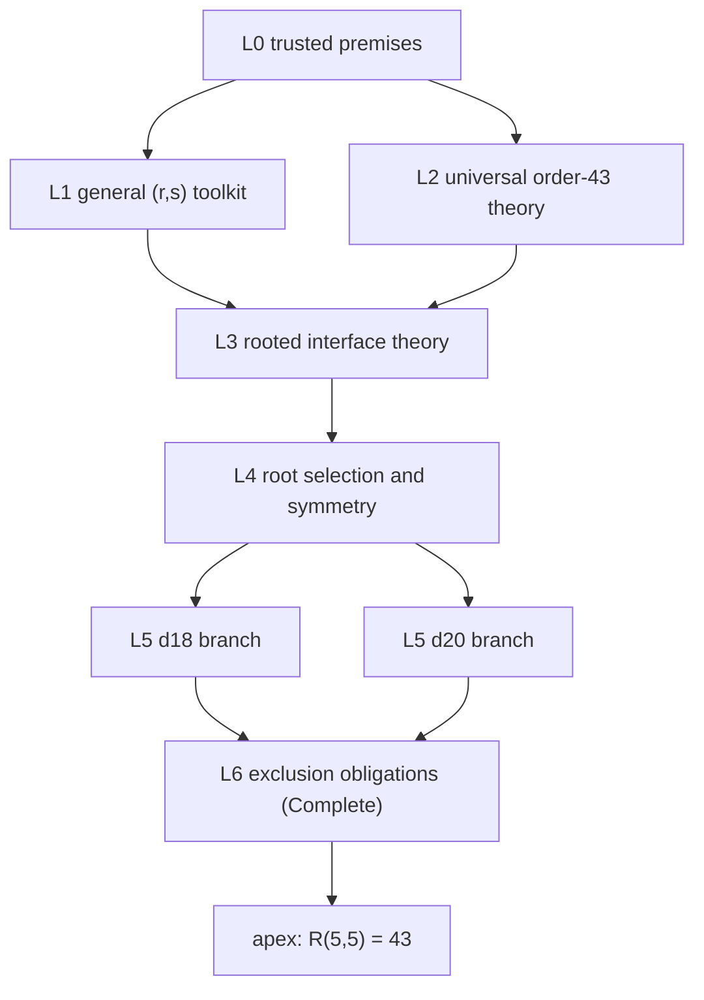
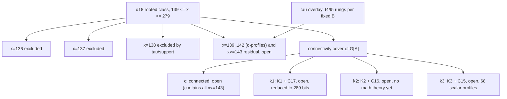

# Theory map: the pyramid to R(5,5) = 43

Status date: 2026-10-19.

This is the dependency-ordered view of the project's mathematics and its
formalization: every proof note, general theorem, and Lean declaration is
attached to one layer of a single pyramid whose apex is `R(5,5) = 43`. It
complements, and does not replace, the predicate-level
[reduction index](../research/n43/reductions.md) and the per-branch READMEs.

Read it in two directions:

- top-down: what the apex still requires (Section 11 is the open ledger);
- bottom-up: what is proved, on which premises, and with what formal status.

**This map certifies nothing.** It records no proofs, promotes no claims, and
adds no premises. A node's status is mirrored from its source note and its
reviews; a source of truth is always the linked file at its current revision.
Layer assignments below are navigation, not mathematical claims about
novelty or strength.

## 1. Overview

| Layer | Content | Primary math sources | Lean modules |
| --- | --- | --- | --- |
| L0 | Published premises: Ramsey numbers and edge censuses | [mathematical baseline](mathematical_baseline.md), [reduction index §15](../research/n43/reductions.md) | `Ramsey/Premises.lean` |
| L1 | General `(r,s)`-free graph toolkit, block/attachment calculus, witness transport and replacement obstructions | [general theorems](general_theorems/README.md), [attachment calculus](general_theorems/ramsey_attachment_calculus.md) | `Ramsey/theorems/` (2 statement-only modules; attachment calculus not formalized) |
| L2 | Universal theory of an order-43 `(5,5)`-free graph: degree window, ambient types, codegrees, cells, counting identities, primality | [reduction index §4, §10.1-10.2, §11](../research/n43/reductions.md), [theory phase I](theory_phase_1.md) | `Ramsey/n43/D18.lean`, `theorems/LocalReductions.lean` |
| L3 | Rooted interface theory for a fixed pivot: partition identities, exact rectangle criterion, row/column bounds, 4-bit anchors, transversal bounds | [reduction index §2, §5-§7, §8.4](../research/n43/reductions.md), [theory phase I §3-4](theory_phase_1.md) | `defs/RootedRamseyGraph.lean`, `theorems/{Counting,PivotInterface,TransversalFour}.lean`, `n17/Regularity.lean` |
| L4 | Root-selection covers and symmetry machinery: even-pivot cover, canonical selectors, residual quotients, gluing | [reduction index §3, §10.3-10.6](../research/n43/reductions.md), [symmetry structure](../research/n43/symmetry_structure.md) | `Ramsey/n43/EvenPivot.lean` |
| L5 | Branch theories: d18 (corridor, x-closures, connectivity subcases, tau overlay) and d20 | [d18 index](../research/n43/d18/README.md) and children | `Ramsey/n43/d18/*`, `Ramsey/n43/d20/*` |
| L6 | Exclusion obligations and the certificate ladder: `Complete` carrier, sorry ledger, SAT proof obligations | [reduction index §14](../research/n43/reductions.md), [workflow](workflow.md) | `defs/Completeness.lean`, branch `Exclusion.lean` targets |
| Apex | Order-43 exclusion + Exoo witness gives `ramseyNumber 5 5 = 43` | [lemma phase II](lemma_phase_2.md) | `Ramsey.lean` (exclusion half; equality assembly not formalized) |

The Lean file tree already mirrors the pyramid: `defs/` holds L0-L3 vocabulary,
`theorems/` holds L1-L3 proofs, `research/n43/EvenPivot.lean` is L4, and
`research/n43/d18/`/`research/n43/d20/` are L5. The obligation glue plus apex are L6. New formalization should keep this
correspondence (see [lean/AGENTS.md](../lean/AGENTS.md)).

## 2. Layer 0 — trusted premises

Everything above this layer must declare its premise chain. On the formal side
the chain is mechanical: `#print axioms` on any theorem reports exactly the
named premises it consumes ([evidence rules](../lean/README.md#evidence-rules-for-proofs)).

| Premise | Status | Math source | Lean axiom |
| --- | --- | --- | --- |
| `R(3,5) ≤ 14` | published (Greenwood-Gleason 1955) | [baseline](mathematical_baseline.md) | `ramsey_3_5_le_14` |
| `R(4,5) ≤ 25` | published (McKay-Radziszowski 1995; HOL4 formalization exists) | [baseline](mathematical_baseline.md) | `ramsey_4_5_le_25` |
| `(4,5)` edge intervals, orders 14 / 17 / 18 / 24 | published census (Angeltveit-McKay, arXiv:2409.15709v2, App. A, Table 1) | [reduction index §15](../research/n43/reductions.md) | `edges_ramsey_4_5_{14,17,18,24}_*` |
| `(4,4)` edge intervals, orders 11-17 | published census (McKay-Radziszowski 1992, Table 1) | [reduction index §15](../research/n43/reductions.md) | `edges_ramsey_4_4_{11..17}_*` |

The published bounds `R(4,3) ≤ 9` and `R(4,4) ≤ 18` are now proved in
[n09/R43.lean](../lean/Ramsey/n09/R43.lean) and
[n18/R44.lean](../lean/Ramsey/n18/R44.lean), using only standard logical axioms.
The order-9 proof uses smaller bounds and handshaking parity. The order-18 proof
uses the additive Ramsey recurrence. Neither remains a trusted premise.

Rules recorded by the sources:

- `R(5,5) ≤ 46` is deliberately **not** a premise of this project; the target
  is an independent order-43 decision.
- `43 ≤ R(5,5)` is carried by the Exoo witness ([Exoo 1989](mathematical_baseline.md)), cited by publication only; no Lean premise carries it.
- A new premise enters only through `lean/Ramsey/Premises.lean` (with source)
  or `docs/mathematical_baseline.md`, never inline in a branch proof.

## 3. Layer 1 — general `(r,s)` toolkit

The historical inventory in [docs/general_theorems/](general_theorems/README.md)
listed 30 general claims and 5 specializations. The independently audited
[attachment-calculus bundle](../research/reports/2026-10-19-ramsey-attachment-calculus.md)
now supplies 16 reviewed statements in four further notes, including explicit
restatements of existing criteria rather than 16 novelty claims. Every result
keeps its stated premises; no Ramsey/census input is implicit.

| Topic | Note | Accepted content (one line) | Consumed by |
| --- | --- | --- | --- |
| Mixed attachment calculus | [ramsey_attachment_calculus.md](general_theorems/ramsey_attachment_calculus.md) | root-cell types, exact coloured higher-arity port interface and order-independent mixed rank convolution | general induced-block interface theory; worked pivot/K3 examples |
| Boundary replacement | [boundary_profiles.md](../research/foundations/boundary_profiles.md) | finite paired truncated profile, exact uniform joins/forgetting/introduction/relabeling and context congruence | certified uniform-context replacement; not arbitrary mixed joins |
| Critical-face transport | [critical_face_transport.md](general_theorems/critical_face_transport.md) | capacities, weighted exact defects, unit labels, transversal demands and conflict-graph obstructions | generic witness-to-colouring theory; worked anchor/core instances |
| Structural profile obstructions | [profile_obstructions.md](general_theorems/profile_obstructions.md) | equal-order replacement lifts forbidden interior automorphisms/modules; equal-profile sibling collisions have symmetric representatives | combines L1 replacement with L2 universal symmetry premises; conditional context obstructions only |
| Safe augmentation | [safe_augmentation.md](../research/foundations/safe_augmentation.md) | safe missing edges form a hypergraph of independence number at most the deficit; star-forest structure at deficit 1 | d18 `a=84` analysis (index §8.9) |
| Signature anchors | [signature_anchors.md](../research/foundations/signature_anchors.md) | exact mixed homogeneous-set criterion; Hall condition, singleton class caps, weighted degree-excess certificates; clique dual | L3 anchor theory, frontier bands |
| Transversal deletion | [transversal_deletion.md](../research/foundations/transversal_deletion.md) | edge lower bound after deleting a t-transversal; exact defect budget and equality structure | tau rungs, index §8.4-8.6 |
| Transversal compatibility | [transversal_compatibility.md](../research/foundations/transversal_compatibility.md) | avoidance forces occurrence; weighted occupancy; degree-gap obstruction to disjoint transversals | x136 r2 closure, w0 |
| Family overlap | [family_overlap.md](general_theorems/family_overlap.md) | equal-degree prescribed families contain a low-codegree edge past a component threshold | d18 dense families |
| Cut capacity | [cut_capacity.md](general_theorems/cut_capacity.md) | degree cut demand across the non-root set forces many low-q roots; composes with family overlap | index §8.12, §8.14 |
| Swap stabilizers | [disjoint_swap_stabilizers.md](general_theorems/disjoint_swap_stabilizers.md) | exact `(C2)^p` swap stabilizer structure; pair-separation orbit bounds | symmetry layer L4 |
| Two-root gluing | [symmetry_pair_gluing.md](general_theorems/symmetry_pair_gluing.md) | overlap maps classified by double cosets; fiber-product completion group; staged quotient coverage | two-root reductions |
| Residual quotients | [symmetry_quotients.md](general_theorems/symmetry_quotients.md) | split extension `K ⋊ H`; exact 2-CNF lex minimization; uniform descent; hierarchical root selection | generator canonicalization (design) |

Formal status: `theorems/TransversalFour.lean` proves the census-based
transversal bound outright; `theorems/TransversalDeletion.lean` states its
note's claims with 17 deliberate `sorry` bodies and
`theorems/TransversalCompatibility.lean` retains 2, all excluded from the main
target (see [theorems catalogue](../lean/Ramsey/theorems/README.md)). Proving
these statement-only theorems is backlog item B1 (Section 10).

## 4. Layer 2 — universal order-43 theory

Hypothesis: only "G on 43 vertices with no `K5` and no `I5`". No pivot chosen.

| Node | Content | Status | Source | Lean |
| --- | --- | --- | --- | --- |
| U1 | degree window `18 ≤ d(v) ≤ 24` | published | [index §4.1](../research/n43/reductions.md) | `Ramsey.n43.D18` `degree_mem` |
| U2 | ambient types: `G[N(v)]` is `(4,5)`-free, `G[M(v)]` is `(5,4)`-free; complement of `G[B]` is `(4,5)`-free | published | [index §4.2](../research/n43/reductions.md) | `defs/RootedRamseyGraph.lean` bundles |
| U3 | pair codegree intervals (edge and nonedge) | proved-here from published numbers | [index §4.3](../research/n43/reductions.md) | `theorems/LocalReductions.lean` |
| U4 | common-cell caps (edge 13, triangle 4, mixed cell 17) with equality rigidity (4-regular `(3,5)` at 13; 8-regular `(4,4)` at 17) | proved-here from published numbers | [index §4.4](../research/n43/reductions.md) | `theorems/LocalReductions.lean` |
| U5 | every vertex lies in a `K4` and an `I4`; globally at least 33 of each | proved-here | [index §4.5](../research/n43/reductions.md), [theory I §1](theory_phase_1.md) | not formalized |
| U6 | Goodman and degree-energy identities: `2e = 903+Delta`, `T+I=(5719+V)/2`, `6T ≥ 5418+13Delta+3V` (and dual), `2h_v = 399-D+delta_v+delta_v^2+2s_v`, `2P` energy sandwich | proved-here (identities), not pruning-strong | [index §11](../research/n43/reductions.md), [theory I §1](theory_phase_1.md), [lemma II §5](lemma_phase_2.md) | not formalized |
| U7 | global symmetry `S_43 x C_2`, free complement action (`C(43,2)` odd); canonical complement selector `D <lex D^c` | proved-here | [index §10.1-10.2](../research/n43/reductions.md), [theory I §2](theory_phase_1.md) | not formalized (selector is prose) |
| U8 | every candidate is prime; every 24-vertex `(5,4)`-free `B` is prime; pair separation at least 8; a nonidentity automorphism moves at least 10 vertices | accepted | [symmetry structure 01-04](../research/n43/symmetry_structure.md) | not formalized |

Standing caveat (tracked by the index and workflow): `N(v)` is `(4,5)`-free
and **may contain `I4`**; `M(v)` is `(5,4)`-free. No `I4` prohibition may be
transferred across this boundary without an extra hypothesis. The tau scheme
records this explicitly as its assumption (S1).

## 5. Layer 3 — rooted interface theory

Hypothesis: a pivot `v` is fixed; `A = N(v)`, `B = M(v)`, `d = |A|`,
`b0 = 42-d`, `a = e(A)`, `b = e(B)`, `x = e(A,B)`.

| Node | Content | Status | Source | Lean |
| --- | --- | --- | --- | --- |
| R1 | partition and counting identities: `sum_(u in A) d(u) = 2a + x + d`, hence `x = 306-2a+Delta_A = 136+2q+E_A` at `d=18`; complement edge identity for `b` | proved-here | [index §2](../research/n43/reductions.md) | `theorems/Counting.lean`, `d18/PivotBudget.lean` |
| R2 | **exact forbidden-rectangle criterion**: given internal types, the interface is valid iff no all-one and no all-zero `(P,Q)` rectangle with `|P|+|Q|=5` | proved-here | [index §5.1](../research/n43/reductions.md) | `theorems/PivotInterface.lean` |
| R3 | single-row/column cardinal bounds with boundary rigidity triggers (`r_u=17`, `r_u=4`, `s_u=13`, `c_y=d-17`) | proved-here | [index §5.2-5.3](../research/n43/reductions.md) | `theorems/LocalReductions.lean`, `n17/Regularity.lean` |
| R4 | pair and higher row/column intersections (edge-intersection `(3,4)`-free at most 8, etc.) | proved-here | [index §5.4](../research/n43/reductions.md) | partially (`LocalReductions`) |
| R5 | signature-forced adjacency (triangle in `C_y ∩ C_z` forces nonedge, etc.) | proved-here | [index §5.5](../research/n43/reductions.md) | not formalized |
| R6 | 4-bit anchor theory: Hall condition, class caps 3/8/17/24, `e(X,B) ≥ 2|B|-12` and dual, simultaneous-equality rigidity (`C8` or `C4 ⊔ C4`, not a contradiction) | proved-here | [index §6](../research/n43/reductions.md), [lemma II §4](lemma_phase_2.md) | not formalized (general versions stated in toolkit) |
| R7 | catalogue-free quadratic interface inequalities | proved-here | [index §7](../research/n43/reductions.md) | not formalized |
| R8 | transversal theory: `tau_4(F) ≥ 4` at `e(F)=68`, `alpha(F) ≤ 3` (15-vertex census); `tau ≥ 4` for all `q ≤ 2`; graded thresholds `tau ≥ 3` for `q ≤ 7`, `tau ≥ 2` at `q = 8`, `tau ≥ 1` at `q ≥ 9` | proved-here; thresholds accepted | [index §8.4-8.6](../research/n43/reductions.md), [deletion-degree transfer](../research/n43/d18/deletion_degree_transfer.json) | `theorems/TransversalFour.lean` (the 68-edge theorem) |

The `tau ≥ 5` strengthening is **open** (four surviving families,
[index §8.5 / §13.5](../research/n43/reductions.md)); branch-specific anchors establish
it inside the excluded x136/x137/x138 cases (Section7.2), not for unrestricted
q or x. Never encode `|C_y|>=5` without the exact proved hypotheses.

## 6. Layer 4 — root selection and symmetry

| Node | Content | Status | Source | Lean |
| --- | --- | --- | --- | --- |
| S1 | even-pivot cover: a 43-vertex graph has an even-degree vertex; allowed even degrees 18/20/22/24; complementation maps 22 to 20 and 24 to 18; so `d18 ∪ d20` covers everything | proved-here | [index §3](../research/n43/reductions.md) | `Ramsey/n43/EvenPivot.lean` (`pivot_cover`, `exists_degree_18_or_20_up_to_compl`) |
| S2 | canonical complement selector and minimum-degree split (18 / 19 / 20 cases with degree-count sign conditions) | proved-here | [index §10.2](../research/n43/reductions.md), [theory I §2](theory_phase_1.md) | not formalized (alternative scheme) |
| S3 | rooted residual action `Aut(G[A]) x Aut(G[B])` on the cross matrix; five listed **unsafe** reductions; canonical-parent generation is design | proved-here + design | [index §10.3-10.4](../research/n43/reductions.md) | not formalized |
| S4 | duplicate-column multiplicities at most 2 through `x=141`; duplicate-swap kernel bounds; rooted automorphism bound `|Aut(G)_v| ≤ 4|Aut(A)|` (`p ≤ 12` through x141); at `x=136`: `p ≤ 10`, kernel order at most 2 | accepted | [d18 symmetry 01-06](../research/n43/d18/symmetry_reduction.md), [symmetry extensions](../research/n43/d18/symmetry_extensions.md), [symmetry structure 05-09](../research/n43/symmetry_structure.md) | not formalized |
| S5 | two-root gluing quotient (double cosets, fiber-product completion, staged coverage) | accepted | [index §10.6](../research/n43/reductions.md), [pair gluing](general_theorems/symmetry_pair_gluing.md) | not formalized |
| S6 | residual symmetry and descent: `K ⋊ H` split, exact 2-CNF lex minimization, uniform descent, hierarchical root selection | accepted (2026-10-19) | [symmetry quotients](general_theorems/symmetry_quotients.md) | not formalized |

**Coverage warning (open obligation).** The even-pivot split is complete, but
choosing a *canonical* pivot among many candidates still requires a verified
tie rule or explicit all-pivot coverage ([index §3](../research/n43/reductions.md)).
Branch closures state rooted predicates; any final certificate must discharge
this selection obligation (Section 8).

## 7. Layer 5 — branch theories

### 7.1 d18 geometry: one branch, three coordinated axes

Object: rooted `(G,v)` with `d_G(v)=18`; `|A|=18`, `|B|=24`, `x = 136+2q+E_A`
with `q = 85-a >= 0`, `E_A = Delta_A >= 0`. Corridor: `139 <= x <= 279`
(lower bound via the three closures below; upper bound reviewed, formalized in
`d18/CrossEdgeBounds.lean`, with equality profiles at 280 and 288 excluded).

The x-split and the connectivity split are **orthogonal complete covers** of
the same class; the tau scheme is an **overlay** (predicate added to a fixed
x-cell and fixed B), not a third partition. A closure of d18 may proceed along
either cover; whichever is used, coverage must be proved for that cover alone
([tau interaction note](../research/n43/d18/tau/README.md), [connectivity
classification](../research/n43/d18/neighborhood_connectivity.md)). Geography
(derived, unreviewed, tau README): every disconnected neighborhood sits at
`a ≤ 68` (`x ≥ 170`), so the `x ≤ 143` territory lies entirely inside `c`.

### 7.2 Closed nodes (excluded, reviewed)

| Node | Exclusion argument | Claims and status |
| --- | --- | --- |
| `x=136` (with all r-children r0..r4) | degree-8 `I4` anchors 2-dominate `A-I`; three disjoint anchors impossible; low-degree structure; both surviving profiles contradict `tau ≥ 5` against the row budget | [frontier exclusion handoff](../research/n43/d18/x136/frontier_exclusion_handoff.md), 4 claims accepted (review + report 2026-10-19); earlier r1/r2/r3/r4 closures retained |
| `x=137` (single profile `q=0, E_A=1`) | exact effective-degree-8 anchor; low-weight set is not a transversal; projected column capacity `117 < 120` | [frontier closure](../research/n43/d18/x137/frontier_closure.md), 3 claims accepted (two reviews 2026-10-19; the exclusion claim's review is conditional on the `ell ≤ 1` claim, itself accepted) |
| `x=138` (q0,E_A=2 and q1,E_A=0) | saturated effective anchors; projected support118<120; q0 extremal-core moment defects and common-anchor four-transversal obstruction | [two-profile closure](../research/n43/d18/x138/README.md),15 closure claims accepted in three independent reviews;3 general support/transfer claims independently accepted ([report](../research/reports/2026-10-19-d18c-tau-frontier.md)); not yet formalized |

Consequence in force: **every degree18 root has x>=139** and2q+E_A>=3.
Zero A-excess requires q>=2 and x>=140. These new consequences are accepted
in the [frontier proof](../research/n43/d18/tau/q0_effective_reduction.md) and
[support theorem](../research/n43/d18/tau/transversal_support.md); earlier ready
[x136 closure consequences](../research/n43/d18/x136_closure_consequences.md) retain
their original scope and review state.

### 7.3 Open x-frontier

- `x=139..142`: case folders with q-profile children
  ([x-ge137 overview](../research/n43/d18/x-ge137/README.md)); all open. Available
  accepted filters: exact profile budgets and adjacent-pivot tables
  ([transfer bounds](../research/n43/d18/transfer_bounds.md)), four-column stability,
  `x142/q3` size-three column theorem (`E_A ≥ 14`, so `q=3` excludes size-3
  columns through `x=155`), interior degree floors/ceilings `L(q)` and
  `d_A ≤ min(13,44-q)`, connectivity thresholds `kappa(A) ≥ 2/3/4` at
  `a ≥ 70/75/81` ([cross-branch synthesis](../research/reports/2026-10-19-cross-branch-synthesis.json)).
- `x ≥ 143` residual: open; no unconditional `x ≤ 142` bound exists.
- Upper-tail sharpenings (accepted, formalized in part): `t=0` gives
  `x ≤ 278`; `t=1, s=8` gives `x ≤ 271`; profile `(2,6,1)` excluded; 3 row
  profiles remain at `x=279`
  ([tail notes](../research/n43/d18/averaging_omission_cuts.md)).

### 7.4 Connectivity deep reductions

| Subbranch | State | Deepest accepted results |
| --- | --- | --- |
| `c` (connected `A`) | open; contains the whole `x<=143` territory | x138 fully excluded by reviewed tau/support theory; the zero-A-excess [q1 slice is excluded](../research/n43/d18/tau/q1_anchor_reduction.md), forcing q>=2 and x>=140 in w0. Earlier [w0 research](../research/n43/d18/c/w0/research.json) remains historical ready work; higher q remains open. No unified c exclusion |
| `k1` (`K1 ⊔ C17`) | open; no exclusion, no construction | partition `{v,u} | C | D | T = 2|17|17|7`; both 17-cores are `SRG(17,8,3,4)`; at least 64 attachment edges per side (65 by signature geometry); 7-cell excess `26..42`; whole-branch `91 ≤ r ≤ 182`; exact completion to **289 Boolean positions** with 8 clique + 3 independent rectangle obstruction types ([k1 research](../research/n43/d18/k1/research.json) and siblings). Formalized as a `Complete` reduction (`d18/k1/Reduction.lean`). The exterior and T-triangle capacity premises are reviewed ([exterior capacity review](../research/n43/d18/k1/review_triangle_capacity_20261019_exterior_audit.md), [report](../research/reports/2026-10-19-k1-whole-branch-obstruction.md)); dense-cell stability is accepted conditional on them. File labels lag (Section 12) |
| `k2` (`K2 ⊔ C16`) | open; **no markdown theory exists** (Lean stub only) | none; sits at `q=24`, `x ≥ 170` by the unreviewed geography note |
| `k3` (`K3 ⊔ C15`) | open | reroot to three 8-vertex B-blocks or a denser connected reroot; balanced case forces total excess `W ≥ 88`; 71 to 68 scalar profiles by the 17-row zero-triple obstruction; exact **360-bit** completion; explicit sharp 20-vertex partial graph showing the 7-neighbor column bound cannot reach 8 ([k3 notes](../research/n43/d18/k3/README.md), all accepted) |

Cross-cutting accepted material feeding every subbranch: pivot-class and
excess bounds (index §8.11-8.12), pairwise refinements (§8.14-8.15),
overlapping cells and dispersed attachment cuts (§8.16), fixed-B extension
capacity (§8.17, conditional on the external complete `(4,5,24)` catalogue
premise), SOS/SDP local theory (§16.1), obstruction coverage. These are
filters, not closures.

### 7.5 d20

- [d20](../research/n43/d20/README.md): open; no branch-specific predicate or proof
  exists. This is the largest single theory gap below the apex.

### 7.6 tau overlay and reviewed support theory

[tau scheme](../research/n43/d18/tau/README.md): per fixed B and x-cell, UNSAT of the
`t4` and `t5` rungs forces `tau_4 ≥ 6`, hence `x ≥ 24*6 = 144`, closing every
live cell139<=x<=143 (three sound orderings; coverage argument recorded).
Solver-rung execution remains scaffolding; the closure cap and A-label
relocation claims are ready, unreviewed. Independently of those claims,
the reviewed mathematical tau/support proofs exclude both x138 profiles.
[General support capacity](../research/n43/d18/tau/transversal_support.md) and
tripartite attachment obstructions are accepted, with rootwise and regular
consequences. Any rung run remains a Layer6 certificate obligation subject
to the paused-computation policy.

## 8. Layer 6 — obligations and the certificate ladder

The formal mortar is `Ramsey.Complete S P` ("every graph of class `P` lies in
set `S`", [defs/Completeness.lean](../lean/Ramsey/defs/Completeness.lean)):

- a cover of class `P` into branch classes joins by `Complete.cover`;
- a branch closes by supplying `Complete S P` with an **empty** `S`
  (`Complete.forall_not_of_eq_empty`), or with a nonempty `S` refuted
  element-wise.

Current obligation ledger ([sorry ledger](../lean/scripts/sorry-ledger.txt)):
`d20.excludes`, and `d18.{c,k1,k2,k3}.excludes` — five branch targets, one
deliberate `sorry` each. Everything else on the formal side is proved. The 19
toolkit statement-only sorries (Section 3) are not obligations of the main
target.

How a computation may discharge an obligation (design,
[index §14](../research/n43/reductions.md)):

1. branch coverage proved mathematically (one complete cover per branch);
2. symmetry omissions proved equivalent to retained cases (L4 machinery);
3. cube coverage of the base formula;
4. a checkable proof (DRAT/FRAT toward LRAT) retained per cube;
5. on the formal side, the certificate enters as `Complete ∅ P` or as a
   per-element refutation of an explicit enumeration.

Engine output alone is candidate evidence, never a certified Ramsey result;
SAT of any rung is a 43-vertex candidate requiring exhaustive 5-subset
verification before any bound claim. The pivot-selection tie rule (Section 6)
must be discharged before any final `d18`/`d20` certificate is complete.

## 9. Apex

`Ramsey.R_5_5_43` (root module) is proved from the two branch obligations.
Axiom chain today: standard axioms plus named premises plus `sorryAx` from
exactly the five branch obligations. The `ramseyNumber 5 5 = 43` equality
assembly is not formalized; the lower-bound half rests on the published
Exoo 1989 witness, cited in the baseline, with no Lean premise.

## 10. Formalization blueprint

Layer-to-module correspondence is Section 1. Conventions:
[lean/AGENTS.md](../lean/AGENTS.md) (placement, visibility, comments, no
markdown links from Lean); statement mirroring and evidence rules:
[lean/README.md](../lean/README.md). A Lean statement must mirror its source
claim exactly; extra hypotheses are flagged, never silently added.

Backlog, dependency-ordered (sources accepted unless noted):

| ID | Item | Why this order |
| --- | --- | --- |
| B1 | prove the 17 `TransversalDeletion` and 2 `TransversalCompatibility` sorries | toolkit completeness; unblocks their use in later branch proofs |
| B2 | formalize the x136 frontier closure; raise the Lean floor to `x ≥ 137` in `PivotBudget` | accepted 2026-10-19; the floor feeds every d18 subbranch |
| B3 | formalize the x137 closure; floor to `x ≥ 138` | accepted; review conditionality already resolved (Section 7.2) |
| B3a | formalize the two-profile x138 tau/support closure; floor to x>=139, zero-A-excess floor to x>=140 | all18 new claims independently accepted; exact proofs/reviews in the dated tau-frontier report, not mirrored into Lean yet |
| B4 | connectivity claims 02 (census slices) and 03 items (a)/(c); item (b) at `m=1` is already in `k1/Rigidity.lean` | completes the connectivity interface the four subcases share |
| B5 | k2 branch theory (mathematics first, then mirror; the Lean stub already exists) | largest d18 subbranch with zero markdown content |
| B6 | d20 branch theory (mathematics first) | the other half of the even-pivot cover has no predicates to mirror yet |
| B7 | optional: accepted tail theorems (`x ≤ 278` etc.), interior/connectivity transfers | sharpening and alternative-scheme support, not obligations |

Formalization is math-first: no Lean statement may outrun its reviewed source
claim. Where the markdown is stronger than Lean (k1 attachments 65 vs the
formalized 64), upgrading is optional and must cite the accepted claim.

## 11. Open-obligation ledger (definition of done)

The pyramid is complete when all of the following hold.

1. Mathematics: each of the five obligations is closed by a reviewed proof or
   a certified computation with complete coverage — `d18` via one complete
   cover (`c+k1+k2+k3`, or the x-cover `x=139..142` plus `x>=143`), and
   `d20` likewise.
2. Pivot selection: a verified canonical tie rule or explicit all-pivot
   coverage for the chosen covers.
3. Formal: the five branch sorries discharged through `Complete`; sorry
   ledger empty except deliberate toolkit statements; `#print axioms` on
   `R_5_5_43` reports only standard axioms and named premises.
4. Certificate: every computational input carries provenance, hashes, and a
   checkable proof per [reproducibility](reproducibility.md) and
   [index §14.4](../research/n43/reductions.md).

None of these holds today. Closed so far: `x=136`, `x=137`, and the formal
spine from premises to the apex modulo the five obligations.

## 12. Known metadata lags

Statuses in this section reflect reviews; the source files' own labels lag.
Do not re-flip labels here; reconciliation is a separate task.

- [x137/frontier_closure.md](../research/n43/d18/x137/frontier_closure.md): labels
  `ready` / `Reviews: none`, but both sibling reviews accepted and the
  closure is integrated (report 2026-10-19).
- [k1/mixed_core_obstruction.md](../research/n43/d18/k1/mixed_core_obstruction.md),
  [k1/signature_geometry.md](../research/n43/d18/k1/signature_geometry.md),
  [critical_core_exterior.md](../research/n43/d18/critical_core_exterior.md) and
  [k1/triangle_capacity.md](../research/n43/d18/k1/triangle_capacity.md): accepted by
  their reviews; file labels `ready`.
  [k1/dense_cell_stability.md](../research/n43/d18/k1/dense_cell_stability.md) is
  accepted **conditional** on the exterior and capacity premises.
- [parameter_landscape](../research/n43/d18/parameter_landscape.md): claims 4-5
  conditionally accepted pending a core audit of claims 1-3; the JSON's
  `reported_x136_closure` field predates integration.

## 13. Update discipline

- Update a node here only after the underlying claim's audit or integration;
  mirror the source's status words exactly (`accepted`, `ready`, `open`,
  `excluded`, plus the index's bracket labels where used).
- New layers or nodes require an audited source topic under `research/`, with
  its current review state and meaningful changes recorded in that file, not
  a dated report. Coordinate active ownership in WORK.md and shared-index edits
  through [workflow](workflow.md).
- This file never substitutes for the authoritative topic and its review state,
  the reduction index's coverage obligations, or the Lean audit. Existing
  separate reviews remain historical sources until migration; unresolved
  disagreements must not be presented here as accepted results.
